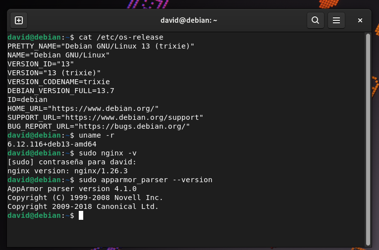
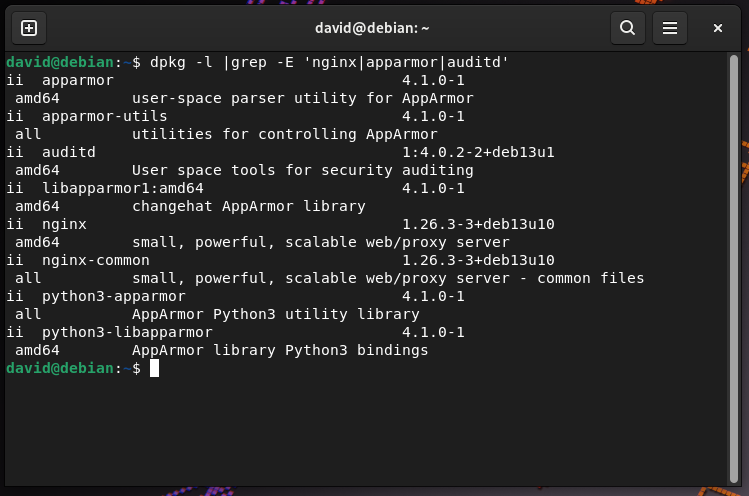
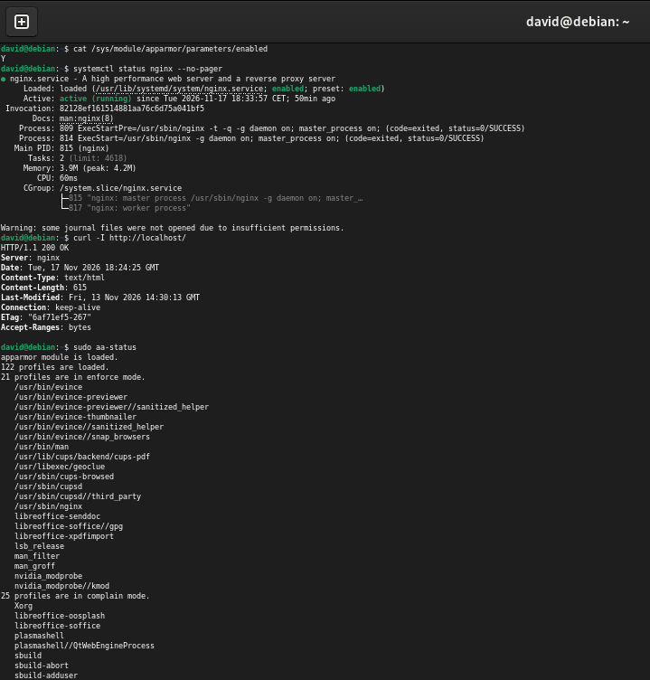
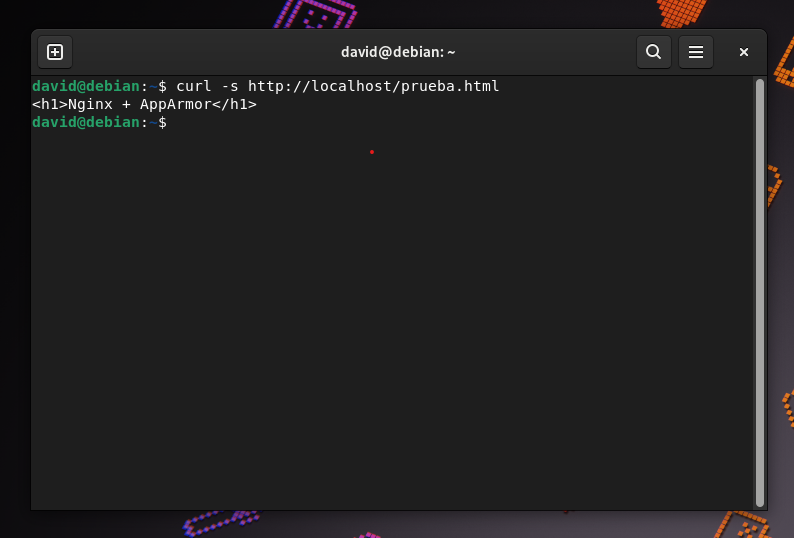

# Confinamiento de Nginx con AppArmor (MAC) en Debian 13

Práctica ASIR · Seguridad en servicios
Autor: David · GitHub: [misteralva](https://github.com/misteralva)

---

## Índice

1. [Objetivo](#1-objetivo)
2. [Entorno utilizado](#2-entorno-utilizado)
3. [Configuración inicial de Nginx](#3-configuración-inicial-de-nginx)
4. [Creación del perfil en modo complain](#4-creación-del-perfil-en-modo-complain)
5. [Evidencias de los registros en complain](#5-evidencias-de-los-registros-en-modo-complain)
6. [Perfil final y paso a enforce](#6-perfil-final-y-paso-a-enforce)
7. [Problema detectado al reiniciar y corrección](#7-problema-detectado-al-reiniciar-y-corrección)
8. [Comprobación de que Nginx responde correctamente](#8-comprobación-de-que-nginx-responde-correctamente)
9. [Prueba de bloqueo de /etc/shadow](#9-prueba-de-bloqueo-de-etcshadow)
10. [Limpieza de la prueba](#10-limpieza-de-la-prueba)
11. [Complain frente a enforce](#11-complain-frente-a-enforce)
12. [Reflexión: accesos permitidos y por qué](#12-reflexión-accesos-permitidos-y-por-qué)

---

## 1. Objetivo

Configurar un servidor web **Nginx** en Debian 13 y confinarlo con un perfil de **AppArmor**, siguiendo este flujo:

1. Instalar y comprobar Nginx.
2. Crear el perfil en modo **complain** (aprendizaje: registra sin bloquear).
3. Generar tráfico real y ajustar el perfil con `aa-genprof` / `aa-logprof`.
4. Pasarlo a modo **enforce** (aplicación: bloquea lo no permitido).
5. Comprobar que el servicio sigue funcionando.
6. Demostrar que Nginx queda impedido de leer `/etc/shadow`, aunque el DAC se lo permita.

AppArmor es un sistema de **Control de Acceso Obligatorio (MAC)**: complementa los permisos clásicos (DAC, `rwx`) con reglas definidas por el administrador y aplicadas por el kernel a cada ejecutable.

## 2. Entorno utilizado

| Elemento | Valor |
|---|---|
| Sistema operativo | Debian 13 "Trixie" (`cat /etc/os-release`) |
| Kernel | ____ (`uname -r`) |
| Nginx | ____ (`nginx -v`) |
| AppArmor | ____ (`apparmor_parser --version`) |
| Auditoría | `auditd` (eventos en `/var/log/audit/audit.log`) |
| Máquina | ____ (VirtualBox / Proxmox / física) |

**Captura 01** — `cat /etc/os-release`, `uname -r`, `nginx -v` y `apparmor_parser --version`.



---

## 3. Configuración inicial de Nginx

### 3.1 Requisito: `sudo`

Una instalación mínima de Debian puede no traer `sudo`. Si falta, como root:

```bash
su -
apt install -y sudo
usermod -aG sudo TU_USUARIO
exit
```

- `su -`: pasa a root.
- `usermod -aG sudo`: `-a` añade sin quitar otros grupos; `-G` indica el grupo. Hay que cerrar sesión y volver a entrar.

### 3.2 Instalación

```bash
sudo apt update
sudo apt install -y nginx apparmor apparmor-utils auditd curl
sudo systemctl enable --now nginx
```

- `apt update`: refresca el índice de paquetes.
- `nginx`: el servidor web (crea el usuario `www-data` y la página por defecto).
- `apparmor` y `apparmor-utils`: el sistema y sus herramientas (`aa-genprof`, `aa-logprof`, `aa-complain`, `aa-enforce`, `aa-status`).
- `auditd`: guarda los eventos de AppArmor en `/var/log/audit/audit.log` (Debian 13 no trae `rsyslog` por defecto).
- `curl`: genera tráfico HTTP.
- `systemctl enable --now`: arranca el servicio ya (`--now`) y en cada arranque (`enable`).

**Captura 02** — instalación de los paquetes terminada (o `dpkg -l | grep -E 'nginx|apparmor|auditd'`).



### 3.3 Comprobaciones previas

```bash
cat /sys/module/apparmor/parameters/enabled
systemctl status nginx --no-pager
curl -I http://localhost/
sudo aa-status
```

- `/sys/module/apparmor/parameters/enabled`: debe devolver `Y` (AppArmor activo en el kernel).
- `systemctl status`: el servicio debe estar `active (running)`.
- `curl -I`: pide solo las cabeceras; debe devolver `200 OK`.
- `aa-status`: lista los perfiles cargados y su modo. Nginx **aún no** debe aparecer.

**Captura 03** — salida de las cuatro órdenes (Nginx funcionando y **sin** perfil).



### 3.4 Página de prueba

```bash
echo "<h1>Nginx + AppArmor</h1>" | sudo tee /var/www/html/prueba.html
curl -s http://localhost/prueba.html
```

- `tee` escribe como root (con un simple `>` la redirección usaría tu usuario y fallaría).
- La página sirve para generar accesos a archivos de `/var/www/html`.

**Captura 04** — respuesta del `curl` a `prueba.html`.



---

## 4. Creación del perfil en modo complain

En Debian, el paquete `nginx` **no incluye** perfil de AppArmor, por lo que se crea con `aa-genprof`.

```bash
ls -l /etc/apparmor.d/ | grep -i nginx
```

- Comprueba si ya existe un perfil de Nginx (no debería).

Se usan **dos terminales**.

**Terminal 1** (se queda esperando):

```bash
sudo aa-genprof /usr/sbin/nginx
```

- `aa-genprof` crea un perfil base, lo pone en **complain** y espera a que se genere actividad.

**Terminal 2** (genera la actividad):

```bash
sudo systemctl restart nginx
curl -s http://localhost/ > /dev/null
curl -s http://localhost/index.nginx-debian.html > /dev/null
curl -s http://localhost/prueba.html > /dev/null
curl -s http://localhost/noexiste > /dev/null
sudo systemctl reload nginx
```

- `restart`: hace que los procesos nazcan bajo el perfil.
- Los `curl`: provocan la lectura de la web y la escritura de logs. La petición a `/noexiste` ejercita el `error.log`.
- `reload`: ejercita el archivo PID y las señales.

**Captura 05** — Terminal 1 con `aa-genprof` esperando y Terminal 2 con los `curl`.


### 4.1 Ajuste con `aa-logprof`

Si el perfil queda incompleto, se vuelve a aprender:

```bash
sudo aa-complain /usr/sbin/nginx
sudo systemctl restart nginx
curl -s http://localhost/ > /dev/null
curl -s http://localhost/prueba.html > /dev/null
sudo aa-logprof
```

- `aa-complain`: devuelve el perfil a modo aprendizaje (no bloquea).
- `aa-logprof`: lee `/var/log/audit/audit.log` y propone reglas una a una.

Opciones del menú: `(A)llow`, `(D)eny`, `(I)gnorar`, `(G)lob` (generaliza la ruta), `(E)xtension`, `(O)wner off`, `Audi(t)` y `(S)ave` / `(F)inalizar`.

**Criterio aplicado:** permitir solo lo que un servidor web necesita, elegir siempre la opción más específica y rechazar las *abstractions* de otros servicios.

| Pregunta de `aa-logprof` | Decisión | Motivo |
|---|---|---|
| `capability dac_override` | Allow | El proceso maestro (root) abre logs que pertenecen a `www-data` |
| `capability net_bind_service` | Allow (opción concreta) | Escuchar en el puerto 80. Se rechazó `abstractions/nis` |
| `capability setgid` / `setuid` | Allow (opción concreta) | Los workers pasan de root a `www-data`. Se rechazaron las abstractions de dovecot, postfix y samba |
| `/var/www/html/prueba.html r` | Glob → `/var/www/html/* r` | Contenido que sirve Nginx. Se rechazó `abstractions/web-data` por ser más amplia |
| `/proc/sys/kernel/random/boot_id` | Allow | Lectura de un identificador de arranque, sin datos sensibles |
| `/run/systemd/userdb/` | Allow | Resolución del usuario `www-data` vía systemd/NSS |
| `/var/log/nginx/access.log w` | Glob → `/var/log/nginx/* w` | Cubre `error.log` y la rotación. Sin `owner`, porque escribe el maestro (root) |
| `/run/nginx.pid rw` | Allow | Guarda y lee el PID del proceso maestro |
| `/etc/nginx/**` (varias rutas) | Allow, solo lectura | Configuración: `nginx.conf`, `mime.types`, `conf.d/`, `sites-*`, `modules-enabled/` |
| `/etc/group`, `/etc/passwd`, `/etc/nsswitch.conf` | Allow, solo lectura | Resolver el usuario y grupo `www-data` |
| Reglas `network ...` con IP y puerto concretos | **Ignorar** | Incluían el puerto efímero del cliente. Se sustituyeron por `network inet stream,` y `network inet6 stream,` |

**Captura 06** — varias preguntas de `aa-logprof` con tu decisión (por ejemplo `dac_override`, la elección entre `abstractions/nis` y `capability net_bind_service`, y el glob de `/var/log/nginx/*`).


**Captura 07** — pantalla final de `aa-logprof` guardando los cambios (`Save Changes`).


---

## 5. Evidencias de los registros en modo complain

En complain, lo que el perfil no cubre **se permite y se registra** como `ALLOWED`:

```bash
sudo grep -a 'apparmor="ALLOWED"' /var/log/audit/audit.log | grep nginx | head -n 20
```

- `grep -a`: lee el log como texto (evita fallos por bytes nulos tras reinicios).
- `grep nginx`: deja solo los eventos del perfil de Nginx.
- `head -n 20`: muestra las 20 primeras líneas.

Formato de un evento (ejemplo del formato, sustituye por el tuyo):

```
type=AVC msg=audit(...): apparmor="ALLOWED" operation="open" class="file"
profile="/usr/sbin/nginx" name="/var/log/nginx/access.log" comm="nginx" requested_mask="wc" ...
```

- `apparmor="ALLOWED"`: el perfil no lo cubría, pero se permitió.
- `operation`: operación realizada (`open`, `capable`, `setsockopt`...).
- `name`: recurso al que se accedió.
- `requested_mask`: tipo de acceso (`r` lectura, `w` escritura...).

**Captura 08** — eventos `ALLOWED` de Nginx (archivos, `capable`, sockets).


---

## 6. Perfil final y paso a enforce

### 6.1 Perfil resultante

```bash
sudo cat /etc/apparmor.d/usr.sbin.nginx
```

Estructura del perfil (**sustituye por el tuyo real**, incluyendo las reglas de `/var/lib/nginx/**` y `chown`):

```
# Last Modified: ...
abi <abi/4.0>,

include <tunables/global>

/usr/sbin/nginx {
  include <abstractions/base>

  capability chown,
  capability dac_override,
  capability net_bind_service,
  capability setgid,
  capability setuid,

  audit deny /etc/shadow r,
  audit deny /etc/shadow w,

  network inet stream,
  network inet6 stream,

  /usr/sbin/nginx mr,
  /var/lib/nginx/** rw,
  /var/log/nginx/* w,
  /var/www/html/* r,
  owner /etc/group r,
  owner /etc/nginx/conf.d/ r,
  owner /etc/nginx/mime.types r,
  owner /etc/nginx/modules-enabled/ r,
  owner /etc/nginx/nginx.conf r,
  owner /etc/nginx/sites-available/* r,
  owner /etc/nginx/sites-enabled/ r,
  owner /etc/nsswitch.conf r,
  owner /etc/passwd r,
  owner /proc/sys/kernel/random/boot_id r,
  owner /run/nginx.pid rw,
  owner /run/systemd/userdb/ r,
}
```

**Captura 09** — `sudo cat /etc/apparmor.d/usr.sbin.nginx` completo.


### 6.2 Reglas `deny` explícitas

```
audit deny /etc/shadow r,
audit deny /etc/shadow w,
```

- `deny`: bloquea el acceso y **tiene prioridad sobre cualquier regla de permiso**. Funciona incluso en modo complain.
- `audit`: obliga a registrar el bloqueo. Sin `audit`, un `deny` bloquea **en silencio** y no deja evento en el log.
- `r` / `w`: lectura y escritura. Equivale a `audit deny /etc/shadow rw,`.

Para aplicar cambios del perfil **sin reiniciar el sistema**:

```bash
sudo apparmor_parser -r /etc/apparmor.d/usr.sbin.nginx
```

- `-r` (*replace*): recarga el perfil en el kernel. Editar el archivo por sí solo **no** actualiza la política cargada.

### 6.3 Activar el modo enforce

```bash
sudo aa-enforce /usr/sbin/nginx
sudo systemctl restart nginx
sudo head -n 8 /etc/apparmor.d/usr.sbin.nginx
sudo aa-status | sed -n '/profiles are in enforce mode/,/profiles are in complain mode/p' | grep nginx
```

- `aa-enforce`: activa el modo de aplicación y **quita `flags=(complain)`** de la cabecera del perfil.
- `restart nginx`: reinicia para que los procesos nazcan con el perfil activo.
- `head -n 8`: la cabecera debe ser `/usr/sbin/nginx {` **sin** `flags=(complain)`.
- La orden con `sed`: imprime solo el bloque de perfiles en *enforce* y filtra Nginx.

**Captura 10** — cabecera del perfil sin `flags=(complain)` y `aa-status` con Nginx en *enforce*.


---

## 7. Problema detectado al reiniciar y corrección

Al activar un perfil **incompleto**, Nginx falló al reiniciar:

```
chown("/var/lib/nginx/body", 0) failed (13: Permission denied)
```

**Causa:** el proceso maestro (root) cambia el propietario de los directorios temporales de `/var/lib/nginx/` al arrancar, y el perfil no incluía:

- `capability chown,`
- permisos de escritura en `/var/lib/nginx/**`.

**Corrección:** se añadieron al perfil y se recargó:

```bash
sudo nano /etc/apparmor.d/usr.sbin.nginx
sudo apparmor_parser -r /etc/apparmor.d/usr.sbin.nginx
sudo nginx -t && sudo systemctl restart nginx
```

- `nginx -t`: valida la sintaxis de la configuración antes de reiniciar.
- `&&`: ejecuta el reinicio solo si la validación fue correcta.

**Lección:** no se debe pasar a enforce sin probar el **arranque y el reinicio** completos, no solo las peticiones HTTP. `aa-logprof` no propuso estas reglas porque no se había ejercitado ese camino durante el aprendizaje.

**Captura 11** — el error `chown(...) failed (13: Permission denied)` (`sudo systemctl status nginx` o `journalctl -xeu nginx`).


**Captura 12** — el perfil con `capability chown` y `/var/lib/nginx/**`, y Nginx arrancando bien tras la recarga.


---

## 8. Comprobación de que Nginx responde correctamente

```bash
systemctl status nginx --no-pager
curl -I http://localhost/
curl -s http://localhost/prueba.html
sudo aa-status | grep -i nginx
sudo grep -a 'apparmor="DENIED"' /var/log/audit/audit.log | grep nginx
```

- `systemctl status`: servicio `active (running)`. El proceso maestro y el worker deben figurar en `aa-status`.
- `curl -I`: `200 OK`.
- `curl -s prueba.html`: devuelve `<h1>Nginx + AppArmor</h1>`.
- `aa-status`: lista `/usr/sbin/nginx` y los PID de los procesos confinados.
- El último `grep`: no debe mostrar `DENIED` sobre accesos legítimos.

**Resultado obtenido:** servicio activo, respuesta `200 OK`, master y worker confinados bajo el perfil y sin denegaciones inesperadas.

**Captura 13** — `systemctl status`, `curl -I` y `curl` a `prueba.html`.


**Captura 14** — `aa-status | grep -i nginx` (con los PID) y el `grep DENIED` sin resultados.


---

## 9. Prueba de bloqueo de /etc/shadow

**Objetivo:** demostrar que el bloqueo lo realiza **AppArmor (MAC)** y no los permisos tradicionales (DAC).

### 9.1 Ruta de prueba en Nginx

Se añadió temporalmente, en el bloque `server` de `/etc/nginx/sites-available/default`:

```
location = /shadow { alias /etc/shadow; }
```

```bash
sudo nginx -t && sudo systemctl restart nginx
```

**Captura 15** — el bloque `location = /shadow` en el archivo de configuración y `nginx -t` correcto.


### 9.2 Superar el filtro DAC

`/etc/shadow` tiene permisos `0640 root:shadow`. Con los workers como `www-data`, el kernel rechazaba la petición **antes** de consultar a AppArmor y no se demostraba nada. Para dejar que solo AppArmor decida, se añadió temporalmente `www-data` al grupo `shadow`:

```bash
sudo usermod -aG shadow www-data
sudo systemctl restart nginx
sudo -u www-data head -n 1 /etc/shadow
```

- `usermod -aG shadow www-data`: añade `www-data` al grupo `shadow`, que tiene lectura sobre el archivo.
- `restart nginx`: los procesos deben reiniciarse para heredar el nuevo grupo.
- `sudo -u www-data head -n 1 /etc/shadow`: lee la primera línea **como `www-data`, fuera de Nginx** (no está confinado por el perfil). Si funciona, confirma que el DAC ya lo permite.

**Captura 16** — `sudo -u www-data head -n 1 /etc/shadow` funcionando (el DAC lo permite).


### 9.3 Denegación implícita y registro

Los `deny` normales **bloquean sin escribir en el log**. Para obtener el evento, se eliminaron temporalmente las dos reglas `deny /etc/shadow` y se recargó el perfil, de modo que actúa la **denegación implícita** (lo no permitido en enforce se bloquea y sí se registra):

```bash
sudo sed -i '/\/etc\/shadow/d' /etc/apparmor.d/usr.sbin.nginx
sudo apparmor_parser -r /etc/apparmor.d/usr.sbin.nginx
curl -i http://localhost/shadow
sudo grep -a 'apparmor="DENIED"' /var/log/audit/audit.log | grep "/etc/shadow"
```

- `sed -i '/patrón/d'`: borra del archivo las líneas que contienen `/etc/shadow`.
- `curl -i`: muestra cabeceras y cuerpo; la respuesta fue `403 Forbidden`.
- `grep -a`: lee el log como texto aunque contenga bytes nulos.

**Resultado obtenido:**

```
type=AVC msg=audit(1794591981.616:686): apparmor="DENIED" operation="open" class="file" profile="/usr/sbin/nginx" name="/etc/shadow" pid=3295 comm="nginx" requested_mask="r" denied_mask="r" fsuid=33 ouid=0 FSUID="www-data" OUID="root"
```

Interpretación de los campos:

| Campo | Significado |
|---|---|
| `apparmor="DENIED"` | AppArmor bloqueó la operación |
| `profile="/usr/sbin/nginx"` | Perfil que aplicó la regla |
| `name="/etc/shadow"` | Recurso al que se intentó acceder |
| `requested_mask` / `denied_mask` | `r`: se pidió lectura y se denegó |
| `fsuid=33` (`www-data`), `ouid=0` (`root`) | Quien accede es `www-data`, el archivo es de root |

**Conclusión:** como `www-data` ya podía leer el archivo por permisos (captura 16), el bloqueo lo realizó **AppArmor**, que es el objetivo de la prueba.

**Captura 17** — `curl -i http://localhost/shadow` con `403 Forbidden`.


**Captura 18** — la línea `apparmor="DENIED"` sobre `/etc/shadow`.


### 9.4 Perfil definitivo con `audit deny`

Para dejar el perfil entregable con las **reglas `deny` explícitas** y que además queden registradas, se repusieron con `audit`:

```
audit deny /etc/shadow r,
audit deny /etc/shadow w,
```

```bash
sudo apparmor_parser -r /etc/apparmor.d/usr.sbin.nginx
```

| Tipo | Bloquea | Registra en el log |
|---|---|---|
| Denegación implícita (sin regla) | Sí | Sí |
| `deny` explícito | Sí (prioridad máxima) | **No**, salvo que lleve `audit` |
| `audit deny` explícito | Sí | Sí |

**Captura 19** — el perfil con las dos líneas `audit deny /etc/shadow ...` y la recarga sin errores.


---

## 10. Limpieza de la prueba

Se revirtieron todos los cambios temporales:

```bash
sudo gpasswd -d www-data shadow
sudo nano /etc/nginx/sites-available/default
sudo nginx -t && sudo systemctl restart nginx
```

- `gpasswd -d www-data shadow`: quita a `www-data` del grupo `shadow`.
- `nano`: se elimina la línea `location = /shadow { ... }`.

Verificación:

```bash
id www-data
sudo -u www-data head -n 1 /etc/shadow
grep -rn "location = /shadow" /etc/nginx/
curl -I http://localhost/
```

- `id www-data`: no debe aparecer el grupo `shadow`.
- `sudo -u www-data head ...`: debe devolver `Permission denied`.
- `grep -rn`: no debe encontrar la ruta de prueba.
- `curl -I`: el servicio sigue respondiendo `200 OK`.

**Captura 20** — `id www-data`, `Permission denied` al leer `/etc/shadow`, `grep` sin resultados y `curl -I` con `200 OK`.


---

## 11. Complain frente a enforce

| | **Complain** | **Enforce** |
|---|---|---|
| Acciones no cubiertas por el perfil | Se **permiten** y se registran (`ALLOWED`) | Se **bloquean** (`EACCES`/`EPERM`) y se registran (`DENIED`) |
| Uso | Aprendizaje y ajuste del perfil | Producción |
| Riesgo | No protege: solo observa | Un perfil incompleto puede romper el servicio |
| Reglas `deny` explícitas | **Se siguen aplicando** | Se aplican |
| Comando | `aa-complain` | `aa-enforce` |
| Cabecera del perfil | `/usr/sbin/nginx flags=(complain) {` | `/usr/sbin/nginx {` |

**El «efecto trampa»:** complain no desactiva todas las restricciones; las reglas `deny` explícitas siguen bloqueando también en ese modo.

---

## 12. Reflexión: accesos permitidos y por qué

Todo lo que Nginx pidió se resume en: **arrancar, resolver su usuario, cambiar de privilegios, leer su configuración y servir contenido**.

| Acceso | Por qué es necesario |
|---|---|
| `/etc/nginx/**` (solo lectura) | Configuración. Nginx no necesita modificarla |
| `/var/www/html/*` (solo lectura) | Contenido que sirve. Nunca escritura |
| `/var/log/nginx/*` (escritura) | Registrar accesos y errores |
| `/run/nginx.pid` | PID del proceso maestro, necesario para `reload` y `stop` |
| `/var/lib/nginx/**` y `capability chown` | Directorios temporales (cuerpo de peticiones, proxy). Se descubrió al fallar el reinicio |
| `capability net_bind_service` | Escuchar en el puerto 80 (<1024) |
| `capability setuid` / `setgid` | Los workers pasan de root a `www-data` |
| `capability dac_override` | El maestro (root) abre logs cuyo dueño es `www-data` |
| `/etc/passwd`, `/etc/group`, `/etc/nsswitch.conf`, `/run/systemd/userdb/` | Resolver `www-data` como usuario y grupo reales |
| `network inet stream` / `inet6 stream` | Sockets TCP para aceptar conexiones HTTP |

**Qué se rechazó y por qué:**

- `abstractions/nis`, `dovecot-common`, `postfix-common`, `samba-rpcd`, `apache2-common`: paquetes de reglas de **otros servicios**, demasiado amplios para Nginx.
- `abstractions/web-data`: da lectura a varios directorios web; se prefirió `/var/www/html/*`.
- Reglas de red atadas a IP y puerto efímero del cliente: solo valían para una conexión concreta.
- Escritura sobre `/etc/**`, `/var/www/**` o `/etc/passwd`: un servidor web no la necesita.
- `/etc/shadow`: bloqueado explícitamente.
