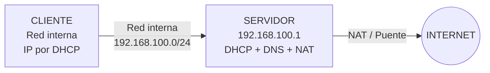
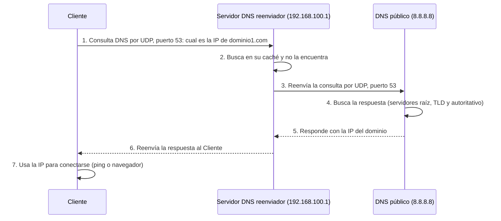

# Actividad 2: Seguridad en el DNS con Wireshark

| Datos de la práctica | |
| --- | --- |
| **Módulo** | 037 Seguridad en servicios |
| **Ciclo formativo** | ASIX |
| **Alumno** | *(escribir aquí nombre y apellidos)* |
| **Práctica** | Seguridad en el DNS |

---

## Índice

1. [Introducción](#1-introducción)
2. [Esquema del laboratorio](#2-esquema-del-laboratorio)
3. [Parte 1: Preparar las máquinas virtuales](#3-parte-1-preparar-las-máquinas-virtuales)
4. [Parte 2: Configurar el servidor](#4-parte-2-configurar-el-servidor)
5. [Parte 3: Comprobar el cliente](#5-parte-3-comprobar-el-cliente)
6. [Parte 4: Instalar y preparar Wireshark](#6-parte-4-instalar-y-preparar-wireshark)
7. [Parte 5: Peticiones DNS normales (sin cifrar)](#7-parte-5-peticiones-dns-normales-sin-cifrar)
8. [Parte 6: Gráfico del camino de una petición DNS](#8-parte-6-gráfico-del-camino-de-una-petición-dns)
9. [Parte 7: DNS sobre HTTPS (DoH)](#9-parte-7-dns-sobre-https-doh)
10. [Conclusiones](#10-conclusiones)
11. [Problemas frecuentes](#11-problemas-frecuentes)
12. [Lista de capturas](#12-lista-de-capturas)

---

## 1. Introducción

### ¿Qué es el DNS?

El **DNS** (*Domain Name System*) es el sistema que traduce los **nombres** de las páginas web (por ejemplo, `ejemplo.com`) en **direcciones IP** (por ejemplo, `93.184.216.34`).

Se puede entender como la **agenda de contactos de Internet**: nosotros recordamos el nombre, pero los ordenadores necesitan el número para comunicarse.

### ¿Qué se pide en esta actividad?

1. Preparar **dos máquinas virtuales**:
   - Un **Cliente**, conectado a una red interna.
   - Un **Servidor** con dos tarjetas de red. Debe dar direcciones IP (DHCP), responder consultas DNS (reenviador) y dar salida a Internet.
2. Hacer **peticiones DNS a 3 dominios** poco habituales (para evitar que estén guardados en la caché).
3. **Observar con Wireshark** qué paquetes se generan: cuántos, de qué tipo, qué puertos usan y si van cifrados.
4. Hacer un **gráfico** del camino que recorre una petición DNS.
5. Activar **DNS sobre HTTPS (DoH)** en el navegador del Cliente, repetir las peticiones y explicar qué cambia en Wireshark.

### Herramientas que usamos

| Herramienta | Para qué sirve |
| --- | --- |
| **VirtualBox** | Crear y ejecutar las máquinas virtuales. |
| **Ubuntu** (Servidor y Cliente) | Sistema operativo de las dos máquinas. |
| **dnsmasq** | Programa que hace de servidor DHCP y de servidor DNS reenviador a la vez. |
| **Wireshark** | Programa que captura y muestra los paquetes de red. |
| **Firefox** | Navegador donde activamos DNS sobre HTTPS. |

> **Nota:** Esta guía está escrita para máquinas con **Ubuntu**. Si el Cliente es **Windows**, al final del apartado 7 se indican los comandos equivalentes.

---

## 2. Esquema del laboratorio



### Datos que utilizaremos

| Elemento | Valor |
| --- | --- |
| Red interna (nombre en VirtualBox) | `intranet` |
| Red del laboratorio | `192.168.100.0/24` |
| IP del Servidor (lado red interna) | `192.168.100.1` |
| Rango DHCP para el Cliente | `192.168.100.50` – `192.168.100.150` |
| DNS que usa el Servidor para salir a Internet | `8.8.8.8` (Google) y `1.1.1.1` (Cloudflare) |

> **Importante:** Los nombres de las tarjetas de red (`enp0s3`, `enp0s8`) pueden ser distintos en cada máquina. Se comprueban siempre con el comando `ip a` y se cambian en los comandos si hace falta.

---

## 3. Parte 1: Preparar las máquinas virtuales

### Paso 1.1: Configurar las tarjetas de red del Servidor

Con el Servidor **apagado**:

1. En VirtualBox, seleccionamos la máquina **Servidor**.
2. Pulsamos **Configuración**.
3. Entramos en el apartado **Red**.
4. En la pestaña **Adaptador 1**:
   - Marcamos **Habilitar adaptador de red**.
   - En **Conectado a** elegimos **NAT** (o **Adaptador puente**, según indique el profesor).
   - Esta tarjeta da la salida a Internet.
5. En la pestaña **Adaptador 2**:
   - Marcamos **Habilitar adaptador de red**.
   - En **Conectado a** elegimos **Red interna**.
   - En **Nombre** escribimos `intranet`.
   - Esta tarjeta conecta con el Cliente.
6. Pulsamos **Aceptar**.

> **Captura 01:** Pestaña *Adaptador 1* del Servidor, donde se vea **NAT** (o puente).


> **Captura 02:** Pestaña *Adaptador 2* del Servidor, donde se vea **Red interna** y el nombre `intranet`.


### Paso 1.2: Configurar la tarjeta de red del Cliente

Con el Cliente **apagado**:

1. Seleccionamos la máquina **Cliente** → **Configuración** → **Red**.
2. En **Adaptador 1**:
   - Marcamos **Habilitar adaptador de red**.
   - En **Conectado a** elegimos **Red interna**.
   - En **Nombre** elegimos **el mismo nombre**: `intranet`.
3. Pulsamos **Aceptar**.

> **Muy importante:** El nombre de la red interna debe ser **exactamente igual** en las dos máquinas. Si no, no se verán entre ellas.

> **Captura 03:** Pestaña *Adaptador 1* del Cliente, donde se vea **Red interna** y el nombre `intranet`.


---

## 4. Parte 2: Configurar el servidor

Encendemos solo el **Servidor** e iniciamos sesión. Todos los comandos de esta parte se escriben en el Servidor.

### Paso 2.1: Ver los nombres de las tarjetas de red

```bash
ip a
```

**Qué hace:** `ip a` (abreviatura de `ip address`) muestra todas las tarjetas de red y sus direcciones IP.

Lo normal es encontrar:

- Una tarjeta con IP (por ejemplo `10.0.2.15`): es la del **Adaptador 1** (salida a Internet). Suele llamarse `enp0s3`.
- Otra tarjeta **sin IP**: es la del **Adaptador 2** (red interna). Suele llamarse `enp0s8`.

> **Captura 04:** Resultado de `ip a` en el Servidor, donde se vean las dos tarjetas.


### Paso 2.2: Poner una IP fija en la tarjeta de la red interna

El Servidor necesita una IP **fija** en la red interna, porque el Cliente la usará como puerta de enlace y como servidor DNS.

1. Miramos cómo se llama el archivo de configuración:

   ```bash
   ls /etc/netplan/
   ```

   **Qué hace:** `ls` lista los archivos de la carpeta `/etc/netplan/`, donde Ubuntu guarda la configuración de red. El archivo suele llamarse `00-installer-config.yaml` o `50-cloud-init.yaml`.

2. Abrimos el archivo con el editor `nano` (cambiar el nombre si es distinto):

   ```bash
   sudo nano /etc/netplan/00-installer-config.yaml
   ```

   **Qué hace:** `sudo` ejecuta el comando como administrador y `nano` es un editor de texto sencillo.

3. Dejamos el contenido así (cambiar `enp0s3` y `enp0s8` si las tarjetas se llaman distinto):

   ```yaml
   network:
     version: 2
     ethernets:
       enp0s3:
         dhcp4: true
       enp0s8:
         dhcp4: false
         addresses:
           - 192.168.100.1/24
   ```

   **Qué significa cada parte:**

   | Línea | Significado |
   | --- | --- |
   | `enp0s3:` | Tarjeta con salida a Internet. |
   | `dhcp4: true` | Esta tarjeta recibe su IP automáticamente (del NAT de VirtualBox). |
   | `enp0s8:` | Tarjeta de la red interna. |
   | `dhcp4: false` | Esta tarjeta **no** pide IP automática. |
   | `addresses:` | Lista de direcciones IP fijas. |
   | `192.168.100.1/24` | IP del Servidor. El `/24` equivale a la máscara `255.255.255.0`. |

   > **Cuidado:** En los archivos `.yaml` los **espacios al principio de cada línea son obligatorios** y no se pueden cambiar por tabuladores.

4. Guardamos y salimos de `nano`: **Ctrl + O**, **Enter** y **Ctrl + X**.

5. Aplicamos los cambios:

   ```bash
   sudo netplan apply
   ```

   **Qué hace:** Lee el archivo y aplica la configuración de red sin reiniciar la máquina.

6. Comprobamos que la IP se ha puesto:

   ```bash
   ip a show enp0s8
   ```

   **Qué hace:** Muestra solo los datos de la tarjeta `enp0s8`. Debe aparecer `192.168.100.1/24`.

> **Captura 05:** Archivo de netplan editado en `nano`.


> **Captura 06:** Resultado de `ip a show enp0s8` con la IP `192.168.100.1/24`.


### Paso 2.3: Activar el reenvío de tráfico (IP forwarding)

Por defecto, un equipo Linux **no** pasa paquetes de una tarjeta a otra. Como el Servidor debe llevar el tráfico del Cliente hacia Internet, hay que activarlo.

1. Activamos el reenvío ahora mismo:

   ```bash
   sudo sysctl -w net.ipv4.ip_forward=1
   ```

   **Qué hace:** `sysctl -w` cambia un parámetro del sistema. Con `net.ipv4.ip_forward=1` el equipo pasa a funcionar como un router.

2. Lo dejamos activado de forma permanente (para que no se pierda al reiniciar):

   ```bash
   sudo nano /etc/sysctl.conf
   ```

   Buscamos la línea `#net.ipv4.ip_forward=1` y **le quitamos el `#`** del principio. Guardamos con **Ctrl + O**, **Enter** y **Ctrl + X**.

   **Qué significa el `#`:** Una línea que empieza por `#` es un comentario y el sistema la ignora.

3. Aplicamos el archivo y comprobamos:

   ```bash
   sudo sysctl -p
   cat /proc/sys/net/ipv4/ip_forward
   ```

   **Qué hace:** `sysctl -p` vuelve a leer el archivo de configuración. `cat` muestra el valor actual, que debe ser **1**.

> **Captura 07:** Resultado de `cat /proc/sys/net/ipv4/ip_forward` mostrando `1`.


### Paso 2.4: Configurar el NAT (para que el Cliente salga a Internet)

Las IP de la red interna (`192.168.100.x`) no existen en Internet. El **NAT** hace que los paquetes del Cliente salgan con la IP del Servidor.

```bash
sudo iptables -t nat -A POSTROUTING -o enp0s3 -j MASQUERADE
```

**Qué hace cada parte:**

| Parte | Significado |
| --- | --- |
| `iptables` | Programa que gestiona el cortafuegos de Linux. |
| `-t nat` | Trabajamos en la tabla `nat` (traducción de direcciones). |
| `-A POSTROUTING` | **A**ñadimos una regla en la cadena `POSTROUTING` (paquetes que están a punto de salir). |
| `-o enp0s3` | Solo para paquetes que salen por la tarjeta `enp0s3` (la de Internet). |
| `-j MASQUERADE` | La acción: sustituir la IP origen por la IP del Servidor. |

Para que la regla **no se pierda al reiniciar**:

```bash
sudo apt update
sudo apt install iptables-persistent -y
sudo netfilter-persistent save
```

**Qué hace:** `apt install` instala el programa `iptables-persistent`. Si pregunta si se desean guardar las reglas actuales, respondemos **Sí**. `netfilter-persistent save` guarda las reglas en disco.

Comprobamos que la regla existe:

```bash
sudo iptables -t nat -L -n -v
```

**Qué hace:** `-L` lista las reglas, `-n` muestra números en lugar de nombres (más rápido) y `-v` da más detalle.

> **Captura 08:** Resultado de `sudo iptables -t nat -L -n -v` con la regla `MASQUERADE`.


### Paso 2.5: Instalar y configurar DHCP y DNS con dnsmasq

El programa `dnsmasq` hace las dos funciones a la vez: **DHCP** (da IP al Cliente) y **DNS reenviador** (pregunta a otros servidores DNS por el Cliente).

> **Nota:** Si en clase ya se configuró un servidor DHCP (por ejemplo `isc-dhcp-server`) y un DNS (por ejemplo `bind9`) con reenviador, **este paso se puede omitir** y se continúa en la Parte 3.

1. Instalamos el programa:

   ```bash
   sudo apt install dnsmasq -y
   ```

2. Creamos un archivo de configuración propio:

   ```bash
   sudo nano /etc/dnsmasq.d/laboratorio.conf
   ```

3. Escribimos este contenido:

   ```ini
   # Solo atiende en la tarjeta de la red interna
   interface=enp0s8
   except-interface=lo
   bind-interfaces

   # DNS: no leer /etc/resolv.conf y reenviar a estos servidores
   no-resolv
   server=8.8.8.8
   server=1.1.1.1

   # DHCP: rango de IP, máscara y tiempo de concesión
   dhcp-range=192.168.100.50,192.168.100.150,255.255.255.0,12h

   # DHCP: puerta de enlace y servidor DNS que recibirá el Cliente
   dhcp-option=option:router,192.168.100.1
   dhcp-option=option:dns-server,192.168.100.1
   ```

   **Qué significa cada línea:**

   | Línea | Significado |
   | --- | --- |
   | `interface=enp0s8` | `dnsmasq` solo trabaja en la red interna. |
   | `except-interface=lo` | No usa la tarjeta interna del propio equipo (evita conflictos con otro servicio que usa el puerto 53). |
   | `bind-interfaces` | Se une solo a las IP de la tarjeta indicada. |
   | `no-resolv` | No lee el archivo `/etc/resolv.conf`; usará solo los servidores indicados. |
   | `server=8.8.8.8` | Servidor DNS de Google al que reenviar las consultas. |
   | `server=1.1.1.1` | Servidor DNS de Cloudflare al que reenviar las consultas. |
   | `dhcp-range=...` | IP que repartirá: de la `.50` a la `.150`, máscara `255.255.255.0`, durante 12 horas. |
   | `option:router` | Puerta de enlace que recibirá el Cliente: el Servidor. |
   | `option:dns-server` | Servidor DNS que recibirá el Cliente: el Servidor. |

4. Guardamos (**Ctrl + O**, **Enter**, **Ctrl + X**), reiniciamos el servicio y lo activamos al arrancar:

   ```bash
   sudo systemctl restart dnsmasq
   sudo systemctl enable dnsmasq
   sudo systemctl status dnsmasq
   ```

   **Qué hace cada comando:**

   | Comando | Significado |
   | --- | --- |
   | `systemctl restart dnsmasq` | Reinicia el servicio para que lea la nueva configuración. |
   | `systemctl enable dnsmasq` | Hace que arranque solo al encender la máquina. |
   | `systemctl status dnsmasq` | Muestra su estado. Debe aparecer **active (running)** en verde. Para salir se pulsa `q`. |

> **Captura 09:** Archivo `/etc/dnsmasq.d/laboratorio.conf` abierto en `nano`.


> **Captura 10:** Resultado de `systemctl status dnsmasq` con **active (running)**.


---

## 5. Parte 3: Comprobar el cliente

Encendemos el **Cliente** (el Servidor sigue encendido) y iniciamos sesión.

### Paso 3.1: Comprobar que ha recibido IP por DHCP

```bash
ip a
```

La tarjeta de red debe tener una IP entre `192.168.100.50` y `192.168.100.150`.

### Paso 3.2: Comprobar el servidor DNS que usa el Cliente

```bash
resolvectl status
```

**Qué hace:** Muestra la configuración DNS del equipo. En la tarjeta de red debe aparecer `DNS Servers: 192.168.100.1`.

### Paso 3.3: Comprobar la conexión

```bash
ping -c 2 192.168.100.1
ping -c 2 8.8.8.8
ping -c 2 google.com
```

**Qué hace cada comando:**

| Comando | Qué comprueba |
| --- | --- |
| `ping -c 2 192.168.100.1` | Que el Cliente llega al Servidor. (`-c 2` envía solo 2 paquetes). |
| `ping -c 2 8.8.8.8` | Que el Cliente llega a Internet pasando por el Servidor (NAT y reenvío correctos). |
| `ping -c 2 google.com` | Que el DNS funciona (convierte el nombre en IP). |

Si los tres funcionan, **el laboratorio está listo**.

> **Captura 11:** Resultado de `ip a` en el Cliente con su IP del rango DHCP.


> **Captura 12:** Resultado de `resolvectl status` con `DNS Servers: 192.168.100.1`.


> **Captura 13:** Resultado de los tres `ping` funcionando.


---

## 6. Parte 4: Instalar y preparar Wireshark

Todo lo siguiente se hace en el **Cliente**.

### Paso 4.1: Instalar Wireshark

```bash
sudo apt update
sudo apt install wireshark -y
```

Durante la instalación aparece una pregunta: *«¿Debería permitirse a los usuarios que no son superusuarios capturar paquetes?»*. Elegimos **Sí**.

Después añadimos nuestro usuario al grupo `wireshark`:

```bash
sudo usermod -aG wireshark $USER
```

**Qué hace:** `usermod -aG wireshark $USER` añade (`-a`) nuestro usuario (`$USER`) al grupo (`-G`) `wireshark`, que tiene permiso para capturar paquetes.

**Cerramos la sesión y volvemos a entrar** (o reiniciamos el Cliente) para que el cambio tenga efecto.

### Paso 4.2: Instalar las herramientas de consulta DNS

```bash
sudo apt install dnsutils -y
```

**Qué hace:** Instala `nslookup` y `dig`, programas para hacer consultas DNS.

### Paso 4.3: Abrir Wireshark y empezar a capturar

1. Abrimos **Wireshark** desde el menú de aplicaciones (o con el comando `wireshark`).
2. En la pantalla inicial aparece una lista de interfaces. Hacemos **doble clic** en la tarjeta de red con IP `192.168.100.x` (normalmente `enp0s3`). Empieza la captura.
3. En la barra superior (**Aplicar un filtro de visualización**) escribimos:

   ```
   dns
   ```

   y pulsamos **Enter**.

   **Qué hace:** El filtro `dns` oculta todo el tráfico que no sea DNS. Así solo vemos lo que nos interesa.

> **Captura 14:** Pantalla inicial de Wireshark con la interfaz elegida.


### Paso 4.4: Entender las partes de la ventana de Wireshark

La ventana se divide en **tres zonas**:

| Zona | Dónde está | Qué muestra |
| --- | --- | --- |
| **Lista de paquetes** | Arriba | Una línea por paquete: número, tiempo, origen, destino, protocolo e información. |
| **Detalles del paquete** | En medio | Al pulsar un paquete, se despliegan sus capas: Ethernet, IP, UDP y DNS. |
| **Bytes del paquete** | Abajo | El contenido del paquete tal como viaja por la red (en hexadecimal y texto). |

---

## 7. Parte 5: Peticiones DNS normales (sin cifrar)

### Paso 5.1: Elegir los 3 dominios

Elegimos **3 dominios reales** que **no se visiten habitualmente** (por ejemplo, una web de un museo pequeño, una asociación o un comercio local) y que **no coincidan con los de los compañeros**.

Para comprobar que existen, los abrimos antes desde el móvil.

> En esta guía los llamamos `dominio1.com`, `dominio2.com` y `dominio3.com`. **Hay que sustituirlos por los dominios reales elegidos** en todos los comandos.

| Petición | Dominio | Herramienta que usamos |
| --- | --- | --- |
| 1 | *(escribir aquí)* | `ping` |
| 2 | *(escribir aquí)* | `nslookup` |
| 3 | *(escribir aquí)* | Navegador (Firefox) |

### Paso 5.2: Limpiar las cachés antes de cada prueba

Si un dominio ya está guardado en una **caché** (memoria temporal), no se hará la consulta y no veremos tráfico. Por eso limpiamos las cachés:

**En el Cliente:**

```bash
resolvectl flush-caches
```

**Qué hace:** Borra la caché DNS del Cliente.

**En el Servidor** (el programa `dnsmasq` también guarda caché):

```bash
sudo systemctl restart dnsmasq
```

**Qué hace:** Reiniciar el servicio vacía su caché.

### Paso 5.3 (opcional, recomendable): Ver también el tráfico en el Servidor

Para ver cómo el Servidor reenvía la consulta a Internet, abrimos **otra terminal en el Servidor** y ejecutamos:

```bash
sudo tcpdump -i enp0s3 -n udp port 53
```

**Qué hace cada parte:**

| Parte | Significado |
| --- | --- |
| `tcpdump` | Programa que captura paquetes desde la terminal. |
| `-i enp0s3` | Escucha en la tarjeta que sale a Internet. |
| `-n` | Muestra IP en lugar de intentar convertirlas en nombres. |
| `udp port 53` | Solo muestra paquetes UDP del puerto 53 (DNS). |

Para detenerlo se pulsa **Ctrl + C**.

> **Captura 15:** Terminal del Servidor con `tcpdump` mostrando consultas hacia `8.8.8.8` o `1.1.1.1`. *(Se hace durante la petición 1.)*


---

### Petición 1: con `ping`

1. En Wireshark pulsamos el botón azul de **reiniciar captura** (aleta de tiburón) y mantenemos el filtro `dns || icmp`.

   **Qué hace el filtro:** Muestra los paquetes DNS **y** los ICMP (los del `ping`).

2. Limpiamos las cachés (paso 5.2).
3. En la terminal del Cliente escribimos:

   ```bash
   ping -c 2 dominio1.com
   ```

   **Qué hace:** `ping` envía paquetes a un equipo para comprobar si responde. Antes de enviarlos, el sistema pregunta por DNS cuál es la IP del dominio.

4. Detenemos la captura en Wireshark (botón rojo cuadrado).

> **Captura 16:** Terminal del Cliente con el resultado del `ping`.


> **Captura 17:** Lista de paquetes de Wireshark con las consultas y respuestas DNS del `ping`.


**Qué debemos observar (normalmente):** Aparecen **4 paquetes DNS**:

| Nº | Dirección | Tipo | Significado |
| --- | --- | --- | --- |
| 1 | Cliente → Servidor | Consulta **A** | Pregunta por la IP versión 4 del dominio. |
| 2 | Cliente → Servidor | Consulta **AAAA** | Pregunta por la IP versión 6 del dominio. |
| 3 | Servidor → Cliente | Respuesta **A** | Contiene la IP del dominio. |
| 4 | Servidor → Cliente | Respuesta **AAAA** | Contiene la IPv6, o ninguna si el dominio no la tiene. |

> **Importante:** El número exacto puede variar. En la memoria hay que **escribir lo que realmente aparece** en las capturas.

### Cómo analizar un paquete DNS en Wireshark

Hacemos **clic** en un paquete de **consulta** y desplegamos las capas de la zona del medio:

| Capa | Dato | Qué significa |
| --- | --- | --- |
| **Internet Protocol Version 4** | `Source` y `Destination` | IP de origen y destino. En la consulta: origen = Cliente, destino = `192.168.100.1`. |
| **User Datagram Protocol (UDP)** | `Source Port` | Puerto de origen: un número alto elegido al azar (por ejemplo `48212`). |
| | `Destination Port` | Puerto de destino: **53**, el puerto estándar del DNS. |
| **Domain Name System (query)** | `Transaction ID` | Número que identifica la pregunta. La respuesta lleva el **mismo número**. |
| | `Flags` | Banderas. En una consulta, `Recursion desired` = el Cliente pide que se busque la respuesta completa. |
| | `Queries` → `Name` | El dominio preguntado. |
| | `Queries` → `Type` | **A** (IPv4) o **AAAA** (IPv6). |

Ahora hacemos clic en un paquete de **respuesta**:

| Dato | Qué significa |
| --- | --- |
| `Flags` → `Response: Message is a response` | Es una respuesta. |
| `Flags` → `Reply code: No error (0)` | La consulta salió bien. Si el dominio no existe aparece `No such name (3)`. |
| `Answers` → `Address` | La IP que corresponde al dominio. |
| `Answers` → `Time to live` | **TTL**: segundos que se puede guardar la respuesta en caché. |
| `[Request In: N]` | Número del paquete de la consulta a la que responde. |

### ¿Los datos van cifrados?

**No.** El DNS tradicional viaja en **texto plano**. Para comprobarlo:

1. Hacemos **clic derecho** sobre un paquete DNS.
2. Elegimos **Seguir** → **Flujo UDP**.
3. Se abre una ventana donde se puede **leer el nombre del dominio** directamente.

Esto significa que cualquier persona que pueda ver la red (una red Wi-Fi pública, un proveedor de Internet, un atacante en medio) puede saber **qué páginas visitamos**, aunque la página web use HTTPS.

> **Captura 18:** Detalle de un paquete de **consulta** con las capas IP, UDP y DNS desplegadas (se ve el puerto 53).


> **Captura 19:** Detalle de un paquete de **respuesta** con la sección `Answers` desplegada.


> **Captura 20:** Ventana *Seguir flujo UDP* donde se lea el dominio en texto plano.


### Tabla de resultados de la petición 1 (rellenar con lo observado)

| Dato | Resultado |
| --- | --- |
| Dominio consultado | |
| Herramienta | `ping` |
| Nº de paquetes DNS generados | |
| Tipos de consulta (A, AAAA…) | |
| IP origen → IP destino | |
| Puerto origen → puerto destino | |
| Protocolo de transporte | UDP |
| ¿Van cifrados los datos? | No |
| IP obtenida en la respuesta | |
| TTL de la respuesta | |
| Código de respuesta | |

---

### Petición 2: con `nslookup`

1. Reiniciamos la captura en Wireshark (con el filtro `dns`).
2. Limpiamos las cachés (paso 5.2).
3. En la terminal del Cliente escribimos:

   ```bash
   nslookup dominio2.com
   ```

   **Qué hace:** `nslookup` pregunta al servidor DNS por un dominio y muestra el resultado. No envía ningún `ping`, solo genera tráfico DNS.

4. Detenemos la captura.

> **Captura 21:** Resultado de `nslookup` en la terminal del Cliente.


> **Captura 22:** Lista de paquetes de Wireshark con las consultas y respuestas de `nslookup`.


> **Captura 23:** Detalle de un paquete de consulta o de respuesta de `nslookup`.


**Qué debemos observar:** Normalmente **4 paquetes** (consulta y respuesta de tipo **A**, y consulta y respuesta de tipo **AAAA**). A veces aparecen paquetes extra.

**Qué responde `nslookup` en su resultado:**

| Línea | Significado |
| --- | --- |
| `Server: 192.168.100.1` | Servidor DNS que ha respondido (nuestro Servidor). |
| `Address: 192.168.100.1#53` | Su IP y el puerto **53**. |
| `Non-authoritative answer` | La respuesta no viene del servidor propietario del dominio, sino de uno intermedio (el reenviador). Es normal. |
| `Address: ...` | La IP del dominio. |

**Prueba adicional (opcional):** Preguntar por un tipo concreto:

```bash
nslookup -type=A dominio2.com
```

**Qué hace:** `-type=A` pide solo la dirección IPv4. Así se genera **solo una consulta y una respuesta (2 paquetes)**.

### Tabla de resultados de la petición 2 (rellenar con lo observado)

| Dato | Resultado |
| --- | --- |
| Dominio consultado | |
| Herramienta | `nslookup` |
| Nº de paquetes DNS generados | |
| Tipos de consulta (A, AAAA…) | |
| IP origen → IP destino | |
| Puerto origen → puerto destino | |
| Protocolo de transporte | UDP |
| ¿Van cifrados los datos? | No |
| IP obtenida en la respuesta | |
| TTL de la respuesta | |
| Código de respuesta | |

---

### Petición 3: con el navegador

1. Cerramos Firefox por completo (si estaba abierto).
2. Limpiamos las cachés (paso 5.2).
3. Reiniciamos la captura en Wireshark (con el filtro `dns`).
4. Abrimos **Firefox** y escribimos en la barra de direcciones `dominio3.com`.
5. Esperamos a que cargue la página y detenemos la captura.

> **Captura 24:** Firefox con la página `dominio3.com` cargada.


> **Captura 25:** Lista de paquetes de Wireshark con las consultas DNS generadas por el navegador.


**Qué debemos observar:** Normalmente aparecen **más paquetes** que con `ping` o `nslookup`, por varios motivos:

- Además de **A** y **AAAA**, el navegador puede pedir el tipo **HTTPS** (tipo 65).
- Una página web usa recursos de **otros dominios** (imágenes, estadísticas, tipografías, anuncios…) y cada uno genera sus propias consultas.

Para ver solo las consultas del dominio elegido, usamos este filtro:

```
dns.qry.name contains "dominio3"
```

**Qué hace:** Muestra solo los paquetes DNS cuyo nombre consultado contiene la palabra `dominio3`.

Para contar los paquetes mostrados, miramos la **barra inferior** de Wireshark: aparece `Mostrado: N`.

> **Captura 26:** Wireshark con el filtro `dns.qry.name contains "dominio3"` aplicado.


### Tabla de resultados de la petición 3 (rellenar con lo observado)

| Dato | Resultado |
| --- | --- |
| Dominio consultado | |
| Herramienta | Navegador (Firefox) |
| Nº de paquetes DNS generados (solo del dominio) | |
| Nº total de paquetes DNS (incluidos otros dominios) | |
| Tipos de consulta (A, AAAA, HTTPS…) | |
| IP origen → IP destino | |
| Puerto origen → puerto destino | |
| Protocolo de transporte | UDP |
| ¿Van cifrados los datos? | No |
| IP obtenida en la respuesta | |
| TTL de la respuesta | |

### Si el Cliente es Windows

| Acción | Ubuntu | Windows |
| --- | --- | --- |
| Ver la IP | `ip a` | `ipconfig /all` |
| Limpiar la caché DNS | `resolvectl flush-caches` | `ipconfig /flushdns` |
| Ver el DNS usado | `resolvectl status` | `ipconfig /all` |
| `ping` con 2 paquetes | `ping -c 2 dominio` | `ping -n 2 dominio` |
| `nslookup` | `nslookup dominio` | `nslookup dominio` (igual) |

---

## 8. Parte 6: Gráfico del camino de una petición DNS

### Camino de la petición (con nuestro laboratorio)



> **Nota:** GitHub muestra este gráfico automáticamente. Si se prefiere, se puede sustituir por un dibujo propio hecho con otra herramienta (por ejemplo draw.io) y guardarlo como imagen.

### Explicación paso a paso

| Paso | Qué ocurre |
| --- | --- |
| 1 | El **Cliente** necesita la IP de un dominio. Envía una **consulta DNS** al Servidor (su servidor DNS configurado por DHCP). Usa **UDP** y el **puerto 53**. |
| 2 | El **Servidor** mira primero en su **caché**. Si el dominio estuviera guardado, respondería ya. |
| 3 | Como no lo tiene, **reenvía** la consulta a un servidor DNS público (`8.8.8.8`). La consulta sale a Internet con la IP del Servidor gracias al **NAT**. |
| 4 | El **DNS público** busca la respuesta preguntando, si hace falta, a los servidores raíz, a los del dominio de primer nivel (`.com`, `.es`…) y a los del propietario del dominio. |
| 5 | El DNS público **devuelve la IP** al Servidor. |
| 6 | El **Servidor** guarda la respuesta en su caché y se la envía al Cliente. |
| 7 | El **Cliente** ya conoce la IP y puede conectarse (con `ping`, con el navegador, etc.). |

> **Captura 27:** Gráfico final (captura de la vista previa en GitHub o imagen propia).


---

## 9. Parte 7: DNS sobre HTTPS (DoH)

### ¿Qué es DNS sobre HTTPS?

Con el DNS normal, las consultas viajan **sin cifrar** (como hemos visto). Con **DNS sobre HTTPS (DoH)**, las consultas DNS viajan **dentro de una conexión HTTPS cifrada** (puerto **443**), igual que una página web segura. Así, nadie en la red puede leer qué dominios consultamos.

| | DNS normal | DNS sobre HTTPS |
| --- | --- | --- |
| Transporte | UDP | TCP |
| Puerto | 53 | 443 |
| Cifrado | No | Sí (TLS) |
| ¿Se ve el dominio consultado? | Sí | No |

### Paso 7.1: Activar DoH en Firefox

1. Abrimos **Firefox** en el Cliente.
2. Pulsamos el **menú** (las tres rayas, arriba a la derecha) → **Ajustes**.
3. En el menú de la izquierda elegimos **Privacidad y seguridad**.
4. Bajamos hasta el apartado **DNS sobre HTTPS** (según la versión puede llamarse *Protección DNS*).
5. Elegimos **Protección máxima**.
6. En **Elegir proveedor** seleccionamos **Cloudflare**.

> **Diferencia entre las opciones:**
> - **Protección aumentada:** usa DoH, pero si falla vuelve al DNS normal.
> - **Protección máxima:** usa **siempre** DoH y, si falla, no carga la página. Es la mejor para demostrar que el DNS va cifrado.

> **Atajo:** También se puede llegar escribiendo `about:preferences#privacy` en la barra de direcciones.

> **Captura 28:** Menú de Firefox donde se vea la ruta hasta *Ajustes*.


> **Captura 29:** Apartado *DNS sobre HTTPS* con **Protección máxima** y el proveedor **Cloudflare** seleccionados.


*(Si se usa Google Chrome: **Configuración** → **Privacidad y seguridad** → **Seguridad** → activar **Usar DNS seguro** y elegir un proveedor.)*

### Paso 7.2: Repetir las peticiones y observar en Wireshark

Repetimos el proceso con **los mismos 3 dominios**, limpiando las cachés antes (paso 5.2) y **reiniciando Firefox** después de activar DoH.

1. En Wireshark reiniciamos la captura.
2. Con el filtro `dns` abrimos en Firefox `dominio1.com`.

**Qué vemos:** Casi **no aparecen paquetes DNS** (o solo una consulta normal, para averiguar la IP del proveedor DoH, por ejemplo `mozilla.cloudflare-dns.com`). **Las consultas de los dominios ya no se ven.**

> **Captura 30:** Wireshark con el filtro `dns` casi vacío mientras Firefox carga la página.


3. Cambiamos el filtro a:

   ```
   tcp.port == 443
   ```

   **Qué hace:** Muestra el tráfico del puerto 443 (HTTPS).

   **Qué vemos:** Una conexión **TCP** hacia el proveedor DoH (por ejemplo, Cloudflare) y, después, paquetes del protocolo **TLS** con la etiqueta `Application Data`. Su contenido es **ilegible**, porque está cifrado.

> **Captura 31:** Lista de paquetes con el filtro `tcp.port == 443` donde se vean paquetes TLS.


4. Para ver el inicio de la conexión cifrada, usamos el filtro:

   ```
   tls.handshake.type == 1
   ```

   **Qué hace:** Muestra solo los paquetes **Client Hello** (el primer mensaje de una conexión TLS).

   Hacemos clic en uno y desplegamos: **Transport Layer Security** → **Handshake Protocol: Client Hello** → **Extension: server_name**. Se puede leer el **nombre del servidor** al que se conecta (por ejemplo, el proveedor DoH). Esto se llama **SNI**.

> **Captura 32:** Paquete *Client Hello* con la extensión `server_name` desplegada.


### Paso 7.3: Comprobar que el Servidor ya no ve las consultas

En el **Servidor**, ejecutamos de nuevo:

```bash
sudo tcpdump -i enp0s8 -n port 53
```

**Qué hace:** Escucha el tráfico DNS (puerto 53) en la tarjeta de la **red interna**. Mientras el Cliente navega con DoH, **no debería aparecer ninguna consulta del Cliente**, porque Firefox ya no usa nuestro servidor DNS.

> **Captura 33:** Terminal del Servidor con `tcpdump` sin consultas del Cliente mientras Firefox navega.


### Paso 7.4: Descifrar el tráfico para poder ver las consultas DoH

Como las consultas DoH van cifradas, Wireshark no puede mostrarlas. Para verlas hay que darle a Wireshark las **claves de cifrado de la sesión**. Firefox puede guardarlas en un archivo.

1. **Cerramos Firefox por completo** (si queda abierto, ignorará el siguiente paso).
2. En una terminal del Cliente escribimos:

   ```bash
   export SSLKEYLOGFILE=$HOME/sslkeys.log
   firefox &
   ```

   **Qué hace cada línea:**

   | Línea | Significado |
   | --- | --- |
   | `export SSLKEYLOGFILE=$HOME/sslkeys.log` | Crea una variable que le indica a Firefox que guarde las claves de sesión en el archivo `sslkeys.log` de nuestra carpeta personal. |
   | `firefox &` | Abre Firefox. El símbolo `&` lo ejecuta en segundo plano para poder seguir usando la terminal. |

3. Comprobamos que el archivo se está llenando:

   ```bash
   ls -l ~/sslkeys.log
   head -n 3 ~/sslkeys.log
   ```

   **Qué hace:** `ls -l` muestra el tamaño del archivo (debe ser mayor que 0) y `head -n 3` muestra sus 3 primeras líneas.

   > **Aviso de seguridad:** Este archivo contiene claves que permiten descifrar el tráfico. **No debe subirse a GitHub.** Es solo para esta prueba y se borra después.

4. En **Wireshark** indicamos dónde está el archivo:
   - Menú **Editar** → **Preferencias**.
   - **Protocols** → **TLS**.
   - En **(Pre)-Master-Secret log filename** pulsamos **Browse…** y elegimos `sslkeys.log`.
   - Pulsamos **Aceptar**.

5. Reiniciamos la captura, hacemos limpieza de cachés y abrimos en Firefox `dominio1.com`, `dominio2.com` y `dominio3.com`.

6. En Wireshark probamos los filtros:

   ```
   http2
   ```

   ```
   dns
   ```

   **Qué vemos ahora:** Paquetes **HTTP/2** que ya aparecen descifrados. Dentro de ellos, Wireshark muestra las **consultas y respuestas DNS** (con el dominio y la IP), igual que antes, pero ahora **viajan dentro de una conexión cifrada**. También se puede comprobar la cabecera `content-type: application/dns-message`, que es el tipo que se usa en DoH.

> **Captura 34:** Ventana de preferencias de Wireshark con el archivo `sslkeys.log` configurado.


> **Captura 35:** Wireshark mostrando las consultas DNS ya descifradas dentro de HTTP/2.


> **Captura 36:** Detalle de un paquete DoH descifrado (dominio consultado y respuesta con la IP).


*(Si se usa Google Chrome, se abre con:* `google-chrome --ssl-key-log-file=$HOME/sslkeys.log` *)*

### Tabla de resultados con DoH (rellenar con lo observado)

| Dato | Resultado |
| --- | --- |
| Navegador y apartado donde se activó DoH | Firefox → Ajustes → Privacidad y seguridad → DNS sobre HTTPS |
| Proveedor elegido | |
| ¿Aparecen paquetes `dns` sin descifrar? | |
| Protocolo y puerto observados | TLS / TCP 443 |
| ¿Van cifrados los datos? | Sí |
| ¿Se ve el dominio consultado? | No (solo tras descifrar con la clave) |
| ¿Lo ve el Servidor DNS del laboratorio? | No |
| ¿Qué dato sigue visible? | El nombre del servidor DoH (SNI) y las IP de destino |

### Limpieza final

Cuando terminemos, borramos el archivo de claves:

```bash
rm ~/sslkeys.log
```

**Qué hace:** `rm` elimina el archivo.

---

## 10. Conclusiones

### Comparación entre el DNS normal y el DNS sobre HTTPS

| Característica | DNS normal | DNS sobre HTTPS (DoH) |
| --- | --- | --- |
| Protocolo de transporte | UDP | TCP |
| Puerto | 53 | 443 |
| Cifrado | No, texto plano | Sí, con TLS |
| ¿Se puede leer el dominio en Wireshark? | Sí, directamente | No, solo con las claves de sesión |
| Filtro útil en Wireshark | `dns` | `tcp.port == 443` / `tls` |
| Servidor DNS que responde | El de la red (nuestro Servidor) | El del proveedor (Cloudflare) |
| ¿Pasa por nuestro servidor DNS? | Sí | No |
| Nº de paquetes por consulta | 2 (consulta y respuesta) por tipo | Más, por el establecimiento de la conexión TLS |

### Ventajas de DoH

- **Privacidad:** quien vigila la red (Wi-Fi pública, proveedor de Internet) no puede ver los dominios consultados.
- **Seguridad:** dificulta que un atacante modifique las respuestas DNS durante el trayecto.

### Inconvenientes de DoH

- El **administrador de la red pierde visibilidad y control**: no puede registrar ni filtrar las consultas DNS de la empresa (por ejemplo, para bloquear páginas peligrosas).
- Las consultas pasan a depender de un **proveedor externo**.
- **No lo oculta todo:** el nombre del servidor al que nos conectamos (SNI) y las IP de destino siguen siendo visibles.

### Conclusión final

*(Escribir aquí, con palabras propias, 3 o 4 líneas con lo que se ha aprendido. Por ejemplo: qué se ve en el DNS normal, qué cambia con DoH y por qué es importante para la seguridad.)*

---

## 11. Problemas frecuentes

| Problema | Posible causa | Solución |
| --- | --- | --- |
| El Cliente no recibe IP | Las dos máquinas tienen nombres de red interna distintos, o `dnsmasq` no está activo. | Revisar el nombre `intranet` en ambas máquinas y ejecutar `sudo systemctl status dnsmasq` en el Servidor. |
| `ping 192.168.100.1` funciona, pero `ping 8.8.8.8` no | Falta el reenvío o el NAT. | Revisar los pasos 2.3 y 2.4 en el Servidor. |
| `ping 8.8.8.8` funciona, pero `ping google.com` no | El DNS no funciona. | Revisar `dnsmasq` y que el Cliente tenga `DNS Servers: 192.168.100.1`. |
| `dnsmasq` no arranca | Otro servicio ya usa el puerto 53. | Revisar que el archivo tenga `bind-interfaces` y `except-interface=lo`. Ver el motivo con `sudo journalctl -u dnsmasq -n 20`. |
| Wireshark dice «No hay permisos para capturar» | El usuario no está en el grupo `wireshark`. | Repetir el paso 4.1 y reiniciar la sesión. |
| No aparece tráfico DNS al repetir una consulta | El dominio está en una caché. | Repetir el paso 5.2 o elegir otro dominio. |
| Con DoH no se descifra nada | Firefox estaba abierto al exportar la variable, o Wireshark no tiene el archivo de claves. | Cerrar Firefox por completo, repetir el paso 7.4 y comprobar que `sslkeys.log` no está vacío. |

---
